<!-- Gerado por scripts/render_cards.py. Não edite à mão. -->
<a href="https://www.lippe.dev"></a>

  <a href="https://www.linkedin.com/in/filipe-vieira-dev/"></a>
  <a href="https://instagram.com/filipev.silva"></a>
  <a href="https://www.lippe.dev"></a>






  <a href="https://github.com/Lippones/Zentry"></a>
  <a href="https://github.com/Lippones/Track-Tidy"></a>
  <a href="https://github.com/Lippones/casecard"></a>
  <a href="https://github.com/Lippones/chat-ai"></a>

